# GOMOKU - KioTranDev

Cờ caro 5 quân đấu với bot, giao diện retro, chơi trên trình duyệt và điện thoại Android.

**Chơi ngay: [gomoku.kiotrandev.tech](https://gomoku.kiotrandev.tech)**. Không cần cài đặt hay đăng ký; bấm **Chơi khách** là vào bàn.

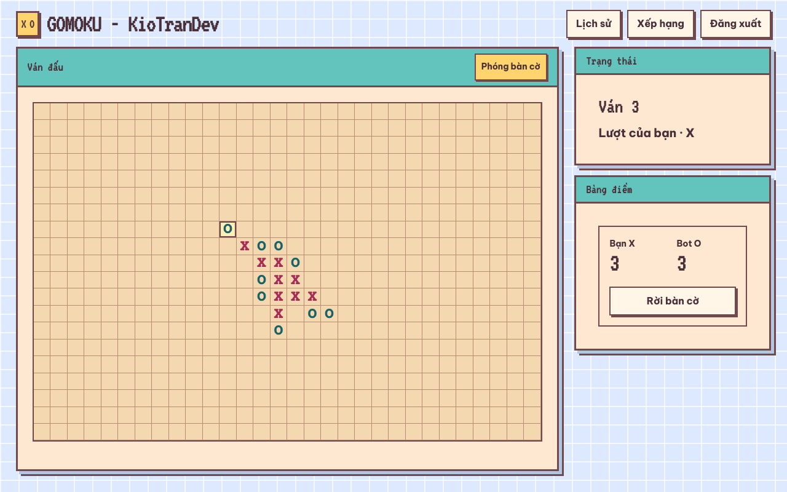

> Các ảnh trong README dùng dữ liệu minh hoạ.

**Mục lục:** [Cách chơi](#cách-chơi) · [Luật thắng](#luật-thắng) · [Tính điểm](#tính-điểm) · [Khách và tài khoản](#khách-và-tài-khoản) · [Dành cho lập trình viên](#dành-cho-lập-trình-viên)

## Cách chơi

### Mục tiêu

Hai bên lần lượt đặt quân lên bàn cờ. Bên nào xếp được **đúng 5 quân liền nhau** theo hàng ngang, hàng dọc hoặc đường chéo thì thắng ván đó.

### Bắt đầu một trận

1. Ở màn hình chính, bấm **Chơi mới**. Nếu đã chơi trước đó, nút **Chơi tiếp** đưa bạn về ván dở.
2. Chọn **Chơi khách**, **Đăng nhập**, hoặc **Đăng ký**. Đã đăng nhập thì chọn **Chơi với tài khoản**.
3. Chọn **quân** (X hoặc O) và **lượt mở** (đánh trước hoặc đánh sau).
4. Bấm **Bắt đầu trận**.

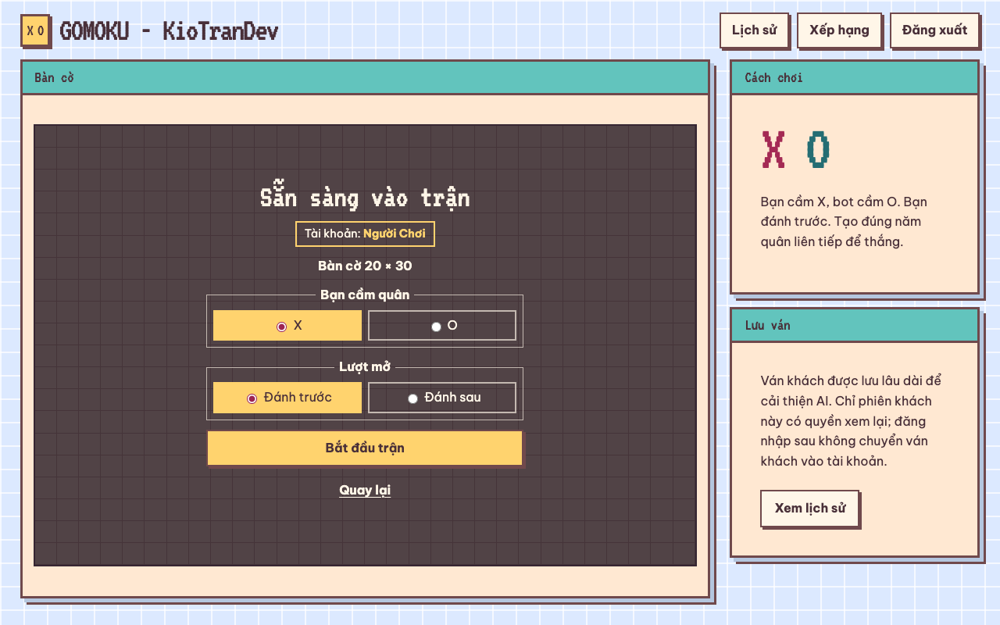

Máy tính dùng bàn **20 × 30**, điện thoại dùng bàn **20 × 20**. Hiệp sĩ là phe của bạn, robot là phe của bot; hai bên chạm trán ở màn mở trận:

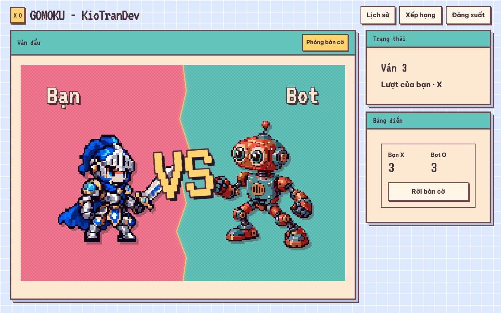

### Đặt quân

| Thiết bị | Cách đánh |
| --- | --- |
| **Chuột** | Bấm thẳng vào ô trống. Cửa sổ nhỏ có thêm nút **Phóng bàn cờ** nếu muốn ô to hơn. |
| **Điện thoại** | Bàn tự phóng to để chạm chính xác. Vuốt để di chuyển, chạm ô để đánh. Bấm **Toàn cảnh** để xem cả bàn, **Phóng bàn cờ** để quay lại. |
| **Bàn phím** | Phím mũi tên để di chuyển, **Enter** hoặc **Space** để đặt quân. |

<table>
  <tr>
    <td>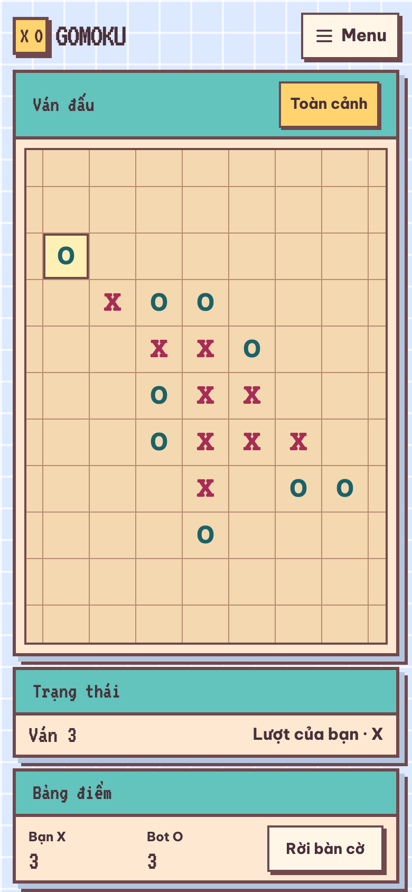</td>
    <td>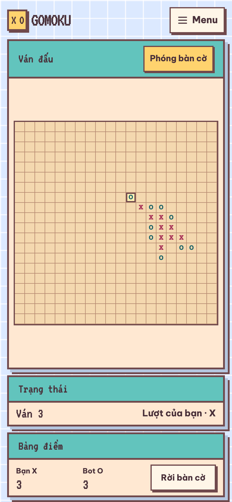</td>
  </tr>
  <tr>
    <td align="center">Phóng to để đánh</td>
    <td align="center">Toàn cảnh để quan sát</td>
  </tr>
</table>

Sau mỗi nước của bạn, ô **Trạng thái** hiện *Bot đang suy nghĩ…*; bot trả lời trong khoảng một giây. Nước đi mới nhất được tô sáng. Ở chế độ phóng to, nếu bot đánh ngoài vùng đang xem, bàn cờ tự cuộn tới nước đó.

### Kết thúc ván

Khi có bên thắng, 5 quân thắng sáng lên rồi hoạt cảnh kết thúc chạy. Hoạt cảnh chỉ phát một lần cho mỗi ván, và có thể bấm **Bỏ qua hoạt cảnh**.

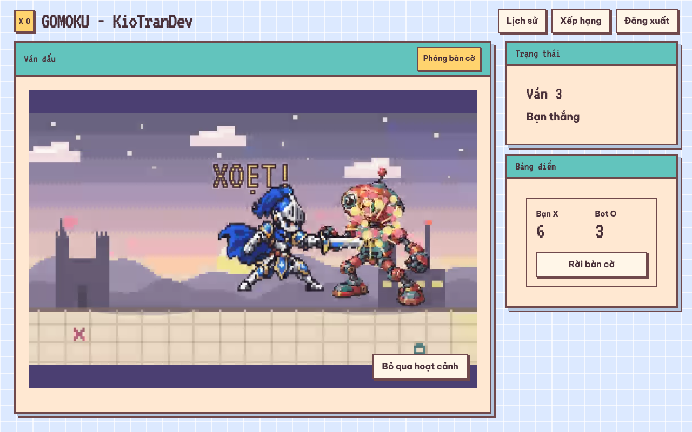

Sau đó bạn có ba lựa chọn:

- **Chơi tiếp:** sang ván mới trong cùng trận, giữ nguyên bảng điểm.
- **Xem lại:** phát lại ván vừa rồi từng nước bằng **Bước trước** và **Bước sau**.
- **Rời bàn cờ:** về màn hình chính. Ván đang chơi được lưu, quay lại lúc nào cũng được.

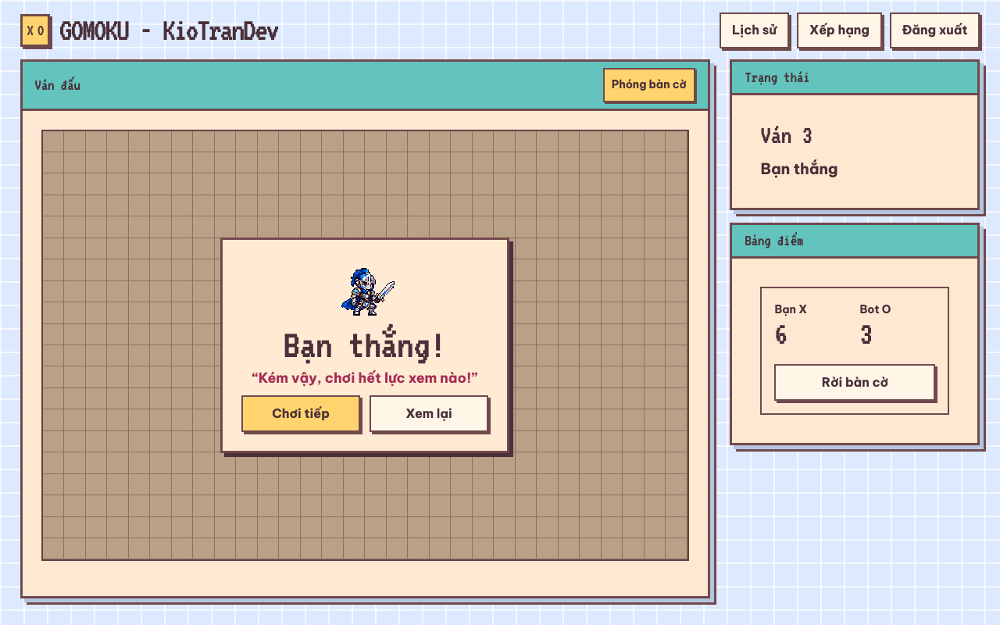

## Luật thắng

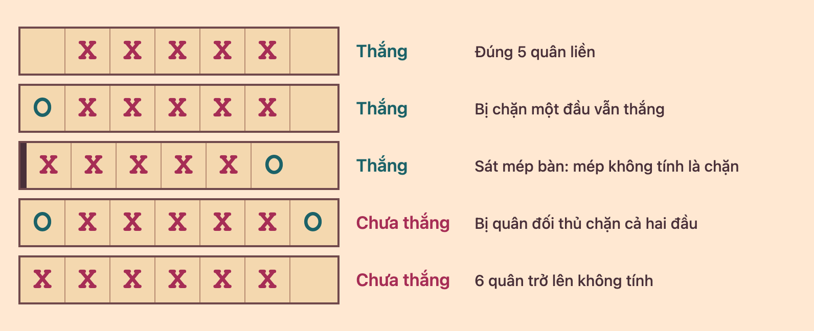

- **Phải đúng 5 quân liền nhau.** Chuỗi từ 6 quân trở lên không tính là thắng, kể cả khi lấp khe nối hai đoạn lại thành 6.
- **Bị chặn một đầu vẫn thắng.** Chuỗi 5 chỉ không được tính khi **quân đối thủ nằm sát cả hai đầu**.
- **Mép bàn không tính là chặn.** Chuỗi sát mép, đầu còn lại bị chặn, vẫn thắng.
- **Hoà** khi bàn cờ kín mà không bên nào thắng.
- **Không có luật cấm** kiểu Renju: mọi ô trống đều đánh được, không đánh đè lên quân đã có.
- **Người mở ván luân phiên** sau mỗi ván đã xong, kể cả ván hoà.

**Mẹo:** chặn sớm khi đối thủ có 3 quân liền còn trống hai đầu, và tìm cách tạo hai đường đe doạ cùng lúc để đối thủ chỉ chặn được một.

## Tính điểm

| Kết quả ván | Bảng điểm trận | Điểm xếp hạng (tài khoản) |
| --- | --- | --- |
| Thắng | +3 | +3 |
| Hoà | +1 cho cả hai bên | +1 |
| Thua | 0 | 0 |

**Bảng điểm** hiện cạnh bàn cờ và tính trong một trận gồm nhiều ván. Trận mới bắt đầu lại từ 0–0.

**Bảng xếp hạng** cộng dồn điểm của mọi ván và chỉ dành cho tài khoản đã đăng nhập. Ván chơi khách không được tính.

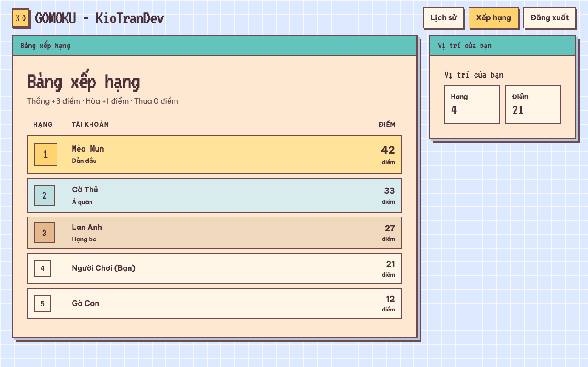

**Lịch sử** có danh sách **Ván dở** để chơi tiếp, và **Ván đã xong** để xem lại từng nước.

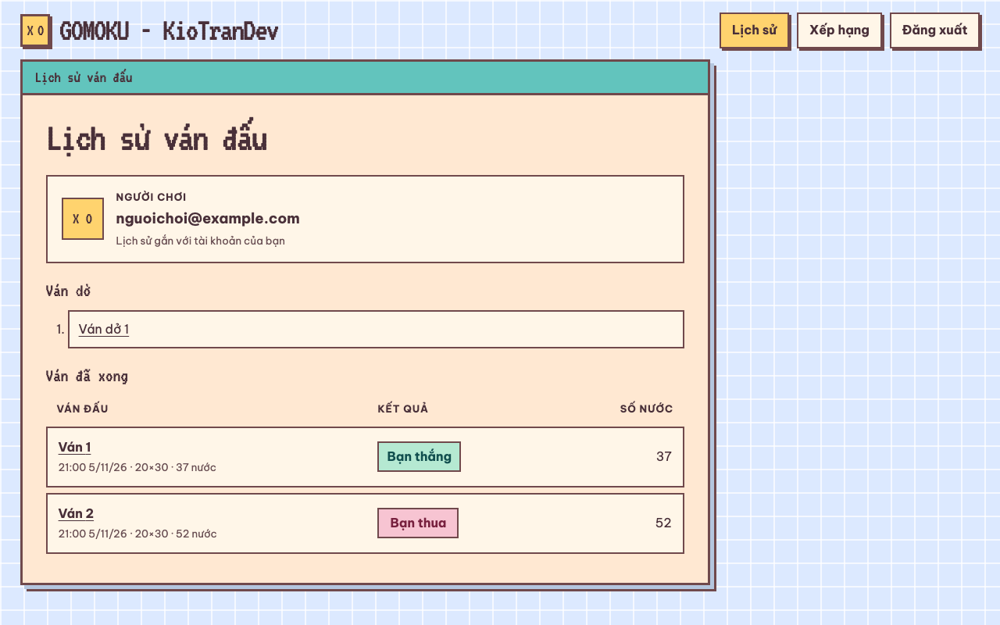

## Khách và tài khoản

| | Chơi khách | Tài khoản |
| --- | --- | --- |
| Cần đăng ký | Không | Email, mật khẩu, tên hiển thị |
| Lưu ván và lịch sử | Trên trình duyệt hoặc app đang dùng, phiên giữ 30 ngày | Theo tài khoản, đăng nhập được ở máy khác |
| Bảng xếp hạng | Không | Có, hiện tên hiển thị của bạn |
| Giữ đăng nhập | Không cần đăng nhập | 30 ngày, tự gia hạn mỗi lần vào chơi |

Màn hình chính luôn cho biết bạn đang chơi bằng tài khoản nào hay đang chơi khách.

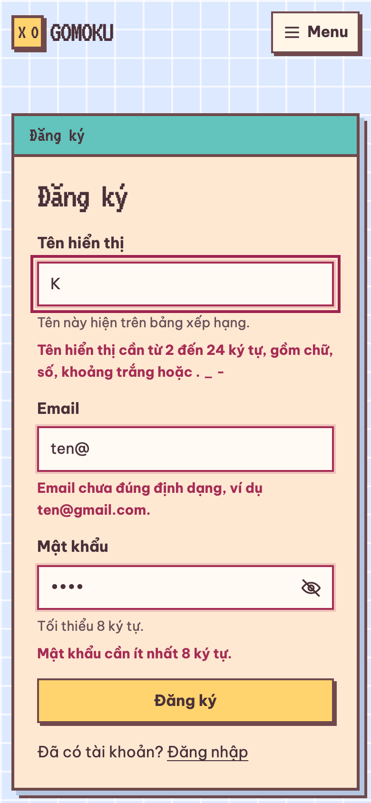

**Khi đăng ký:**

- **Tên hiển thị:** 2–24 ký tự, gồm chữ (có dấu), số, khoảng trắng hoặc `.` `_` `-`.
- **Mật khẩu:** tối thiểu 8 ký tự, không bắt buộc chữ hoa hay ký tự đặc biệt.
- Nhập sai ô nào, lỗi hiện ngay dưới ô đó.

**Cần lưu ý:**

- Nhập sai mật khẩu 5 lần liên tiếp, tài khoản bị tạm khoá vài phút.
- Ván chơi khách **không chuyển** sang tài khoản khi đăng nhập sau đó.

<br clear="right">

## Dành cho lập trình viên

### Công nghệ

| Thành phần | Vai trò |
| --- | --- |
| [`backend/Gomoku.Core`](backend/Gomoku.Core) | Bàn cờ và luật chơi |
| [`backend/Gomoku.AI`](backend/Gomoku.AI) | Bot: tìm kiếm alpha-beta và đánh giá thế cờ, tối đa 1 giây mỗi nước |
| [`backend/Gomoku.Application`](backend/Gomoku.Application) | Luồng ván đấu, lịch sử, bảng xếp hạng |
| [`backend/Gomoku.Infrastructure`](backend/Gomoku.Infrastructure) | PostgreSQL, Redis |
| [`backend/Gomoku.Api`](backend/Gomoku.Api) | ASP.NET Core API, xác thực, phục vụ bản build React |
| [`frontend/`](frontend) | React, TypeScript, Vite; app Android bằng Capacitor |
| [`tests/`](tests), [`scripts/`](scripts) | Kiểm thử và lệnh vận hành |

Backend dùng .NET 10, frontend dùng Node.js 24. `tools/` và `training/` chứa công cụ tự đấu và huấn luyện mô hình; game đang chạy không dùng tới chúng.

### Chạy trên máy

Cần Docker và Docker Compose:

```bash
docker compose up --build --wait -d api
```

Mở **http://127.0.0.1:58080**, kiểm tra bằng `curl http://127.0.0.1:58080/ready`. Dừng bằng `docker compose down`; dữ liệu vẫn giữ trong Docker volume. Nếu cổng `55432` đã bị chiếm, chạy với `GOMOKU_POSTGRES_PORT=55433`.

Chạy frontend bằng Vite, API vẫn ở Docker:

```bash
npm ci
VITE_API_PROXY_TARGET=http://127.0.0.1:58080 npm run dev -w frontend
```

### Kiểm tra

Bật hook một lần sau khi clone. Mỗi lần `git push`, hook chặn nếu còn file chưa commit và chạy kiểm tra nhanh trên bản sạch của commit (khoảng 1,5 phút):

```bash
git config core.hooksPath .githooks
```

```bash
bash scripts/preflight.sh                # chính là bước hook chạy
bash scripts/test-web.sh                 # typecheck, lint, test, build frontend
bash scripts/verify-phase4.sh verify     # đầy đủ: frontend, API, E2E trong Docker cô lập
```

Script E2E mặc định dùng Google Chrome nếu máy có cài. Muốn dùng trình duyệt khác để không đụng Chrome đang mở, thêm `GOMOKU_E2E_BROWSER_CHANNEL=msedge`.

### App Android

App Android tải game từ server, nên sửa game không cần phát hành APK mới. Chỉ cần build lại khi đổi địa chỉ server, icon hoặc phần native. Cần JDK 21 và Android SDK:

```bash
GOMOKU_APP_URL=https://gomoku.kiotrandev.tech bash scripts/build-android-lan.sh
```

File nằm ở `artifacts/android/gomoku-debug.apk`. Bỏ `GOMOKU_APP_URL` để build bản trỏ tới IP LAN của máy đang chạy Docker. Icon và màn khởi động được tạo bằng `scripts/render-android-icons.mjs`.

### Triển khai

Bản public chạy trên một VM Linux nhỏ, sau Cloudflare Tunnel ([`compose.tunnel.yaml`](compose.tunnel.yaml)), nên không cần mở port. VM chỉ cần Docker và khoảng 1 GB RAM cộng swap.

```bash
bash scripts/deploy-vm.sh azureuser@<ip-vm>
```

Script build trên máy local, chỉ upload phần ứng dụng (khoảng 40 MB) và ghép image trên VM. Cấu hình nằm trong `.env.vm` (không commit) gồm `GOMOKU_PUBLIC_HOST`, `CLOUDFLARE_TUNNEL_TOKEN`, `GOMOKU_POSTGRES_PASSWORD`. Thêm `--with-data` ở lần đầu để chuyển database và khoá đăng nhập từ máy local.

Mỗi tunnel chỉ chạy trên một máy, nếu không Cloudflare sẽ chia người chơi cho cả hai máy.

Repo cũng có [`compose.production.yaml`](compose.production.yaml) dùng Caddy cho máy chủ mở port 80/443.

### CI

[GitHub Actions](.github/workflows/verify.yml) chạy `verify-phase4.sh` trên mỗi PR. Push lên `main` còn đẩy image lên GitHub Container Registry theo tag `sha-<commit>`. CI **không tự triển khai**; bản public chỉ cập nhật khi chạy `deploy-vm.sh`. Xem thêm [chi tiết CI/CD](.github/CI-CD.md).

### Hoạt cảnh và sprite

Video kết thúc được render từ sprite bằng `scripts/render-finish-cutscenes.sh` (cần Swift), đầu ra nằm ở `frontend/src/assets/finish/`. Sprite pixel được tạo bằng `scripts/pixelate-sprites.mjs` từ `frontend/media-src/sprites/`.
